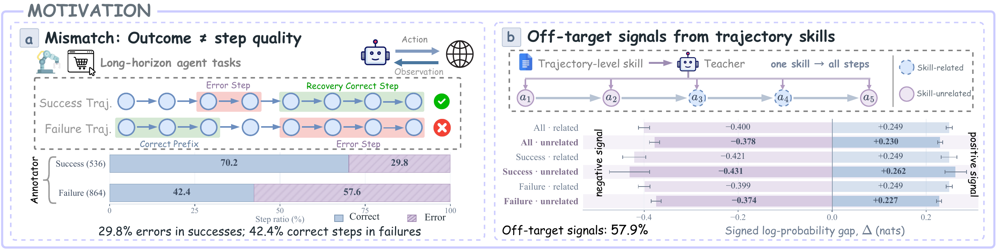
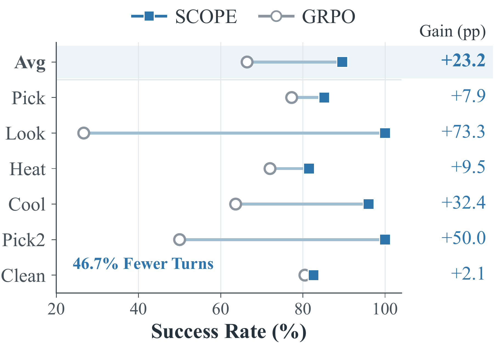
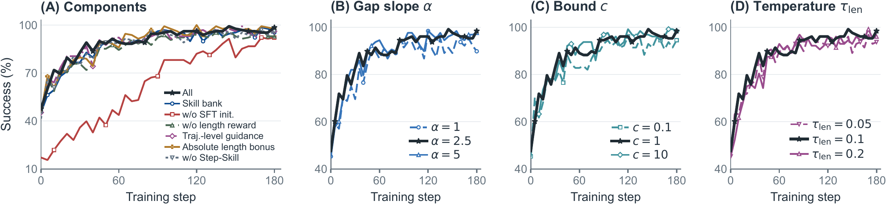
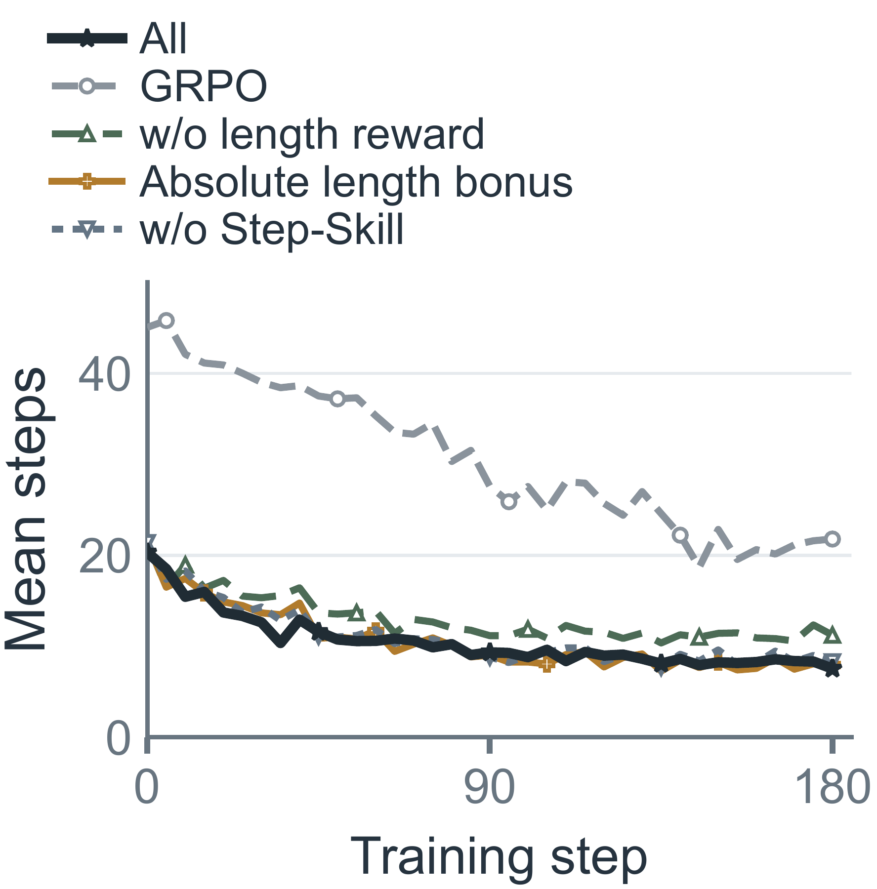

<div align="center">


**Selective Critical-Step On-Policy Self-Distillation**<br>
**for Agentic Reinforcement Learning**

<!-- AUTHORS: Add the final author list here, in publication order. -->

<p align="center">
  <a href="https://neuqrui.github.io/SCOPE-page/">🌐 Project Page</a> &nbsp;·&nbsp;
  <span>📄 arXiv (coming soon)</span> &nbsp;·&nbsp;
  <a href="https://github.com/neuqrui/SCOPE">💻 Code</a> &nbsp;·&nbsp;
  <a href="docs/reproduction.md">🚀 Reproduction Guide</a>
</p>
<!-- ARXIV: Replace the coming-soon label with the final arXiv abstract URL. -->
</div>

## 💡 Overview

Long-horizon agents need feedback on individual decisions. A successful trajectory can contain mistakes that the agent later recovers from, while a failed trajectory can contain correct steps. Applying the same hindsight skill to an entire trajectory also introduces supervision at decisions unrelated to that skill.

**SCOPE** learns from self-generated, **step-specific corrective skills**. After a supervised warm-up, the policy analyzes its own successful and failed experience, identifies error steps, and distills the corresponding skills only at those decisions. A bounded signed distillation coefficient controls the auxiliary signal, and a success-relative pairwise reward encourages efficient task completion.

With **Qwen2.5-3B**, SCOPE achieves **97.7% ALFWorld success** and **85.2% WebShop success**, improving over SEED by **5.9** and **6.3 percentage points**. On ALFWorld Unseen, success rises from **66.4% to 89.6%** over GRPO, while reported average interactions fall by **46.7%**.

<p align="center">
  
</p>
<p align="center"><em>Our WebShop annotations find errors in 29.8% of steps from successful trajectories and correct decisions in 42.4% of steps from failed trajectories. Skill-unrelated steps account for 57.9% of nonzero sampled-token teacher–student gaps.</em></p>

## ✨ Highlights

- **Self-bootstrapped step-level skills.** The policy serves as both actor and analyzer, turning its own experience into structured corrections with explicit target steps.
- **Selective, bounded signed OPSD.** Each skill conditions the teacher only at its assigned steps. A smooth tanh coefficient retains both reinforcement and suppression while bounding its magnitude.
- **Success-relative efficiency.** A soft pairwise comparison favors shorter successful trajectories within the same task group, without specifying an absolute target length.

At evaluation, the trained agent acts from the ordinary interaction history. Skills and analyzer calls are used during training; external annotation is confined to the offline warm-up.

<a id="method"></a>

## 🧭 Method

<p align="center">
  
</p>
<p align="center"><em>SCOPE learning loop: collect experience → identify errors and generate step-level skills → combine selective self-distillation with efficiency-aware GRPO → update the policy and analyzer.</em></p>

**1. Initialize analysis.** Collect base-policy trajectories and annotate errors with corrective skills. Supervised fine-tuning teaches the policy the structured analysis format. Each skill entry contains `target_steps`, `error_reason`, and `skill`.

**2. Analyze on-policy experience.** Sample eight trajectories per task. The current policy snapshot analyzes both successful and failed rollouts; failures can additionally use up to three successful action sequences from the same group as references. The analyzer returns up to five skill entries, each assigned to one or more steps.

**3. Learn at the selected steps.** The skill-conditioned teacher and ordinary-context student score the same sampled response tokens. Teacher scores are cached before student optimization. Selected steps receive the bounded signed OPSD signal alongside GRPO; other steps receive ordinary RL updates.

**4. Reward efficient success.** Compare interaction lengths among successful trajectories for the same task. Add the resulting pairwise bonus to the task reward, then update the policy. The updated policy supplies both the actor and analyzer for the next iteration.

<details>
<summary><b>Bounded signed OPSD and pairwise reward</b></summary>

For a selected response token, let $\pi_T$ and $\pi_S$ denote teacher and student probabilities. We use the signed log-probability gap

```math
\begin{aligned}
\Delta &= \log\pi_T-\log\pi_S, \\
w(\Delta) &= c\,\tanh\left(\frac{\alpha}{c}\,\mathrm{sg}[\Delta]\right).
\end{aligned}
```

Here `sg` stops gradients through the coefficient, $\alpha$ sets the slope near zero, and $c$ bounds its magnitude. The auxiliary loss averages $-w(\Delta)\log\pi_S$ over selected response tokens. Positive gaps reinforce a sampled token; negative gaps suppress it. An empty selection contributes zero auxiliary loss. Defaults are $\alpha=2.5$, $c=1$, and distillation weight $\lambda_{\mathrm{OPSD}}=0.01$.

For successful trajectory $i$, let $T_i$ count environment interactions and let $S$ be the set of successful trajectories in its task group. Pairwise preferences and the efficiency bonus are

```math
\begin{aligned}
p_{ij} &= \sigma\left(\frac{\log T_j-\log T_i}{\tau_{\mathrm{len}}}\right), \\
b_i &= \frac{1}{|S|-1}\sum_{j\in S\setminus\{i\}}p_{ij}.
\end{aligned}
```

The sigmoid $\sigma$ provides a smooth preference for the shorter success. The shaped reward is $R_i+\lambda_{\mathrm{len}}b_i$, with $\tau_{\mathrm{len}}=0.1$ and $\lambda_{\mathrm{len}}=5$. A lone success receives $b_i=1/2$; failures keep their original task reward. The comparison depends on length ratios and is invariant to multiplying all interaction lengths by the same positive factor.

</details>

Explore the [interactive method demos](https://neuqrui.github.io/SCOPE-page/#method) and [recorded ALFWorld / WebShop trajectories](https://neuqrui.github.io/SCOPE-page/#replay) on our project page.

<a id="results"></a>

## 📊 Results

We evaluate three Qwen backbones on **ALFWorld** and **WebShop**. SCOPE achieves the highest WebShop success and the highest or tied highest ALFWorld success among the evaluated methods for each backbone.

| Backbone | ALFWorld success ↑ | Gain over SEED | WebShop success ↑ | Gain over SEED |
| :--- | ---: | ---: | ---: | ---: |
| Qwen2.5-3B-Instruct | **97.7%** | **+5.9 pp** | **85.2%** | **+6.3 pp** |
| Qwen2.5-7B-Instruct | **98.4%** | **+2.3 pp** | **84.4%** | **+6.3 pp** |
| Qwen3-1.7B | **92.2%** | **+0.2 pp** | **78.9%** | **+1.6 pp** |

Main results use SCOPE at **training step 150**. Each benchmark contains 128 evaluation tasks or episodes; ALFWorld uses the seen split. Gains are absolute percentage-point differences.

<details>
<summary><b>Comparison with GRPO, SDAR, GRSD, and SEED</b></summary>

WebShop reports both normalized task score (partial requirement matching) and success rate (full task completion). All values below are percentages.

| Backbone | Method | ALFWorld success ↑ | WebShop score ↑ | WebShop success ↑ |
| :--- | :--- | ---: | ---: | ---: |
| Qwen2.5-3B-Instruct | GRPO | 75.0 | 79.8 | 63.3 |
| | SDAR | 84.4 | 85.0 | 68.0 |
| | GRSD | 86.7 | 86.9 | 76.5 |
| | SEED | 91.8 | 88.5 | 78.9 |
| | **SCOPE** | **97.7** | 87.9 | **85.2** |
| Qwen2.5-7B-Instruct | GRPO | 81.2 | 80.9 | 72.6 |
| | SDAR | 85.9 | 89.4 | 82.8 |
| | GRSD | 92.2 | 91.6 | 82.8 |
| | SEED | 96.1 | 89.7 | 78.1 |
| | **SCOPE** | **98.4** | 89.6 | **84.4** |
| Qwen3-1.7B | GRPO | 46.1 | 67.3 | 38.3 |
| | SDAR | 53.9 | 76.8 | 58.6 |
| | GRSD | **92.2** | 84.5 | 66.4 |
| | SEED | 92.0 | 87.1 | 77.3 |
| | **SCOPE** | **92.2** | 83.2 | **78.9** |

</details>

### Generalization and interaction efficiency

On **ALFWorld Unseen**, SCOPE achieves **89.6% success**, compared with **66.4% for GRPO**. Reported average turns decrease from **18.86 to 10.06**.

<p align="center">
  
</p>

<details>
<summary><b>Ablations and training dynamics</b></summary>

ALFWorld component ablations use **Qwen2.5-3B at step 180**.

| Variant | ALFWorld success ↑ |
| :--- | ---: |
| **Full SCOPE** | **98.4%** |
| Without SFT initialization | 92.2% |
| Without Step-Skill | 96.1% |
| Trajectory-level guidance | 96.1% |
| Skill-bank guidance | 95.3% |
| Without length reward | 93.0% |
| Absolute length bonus | 97.7% |

<p align="center"></p>
<p align="center"><em>Component ablations and parameter sweeps during ALFWorld training.</em></p>

<p align="center"></p>
<p align="center"><em>Mean response steps on ALFWorld. The GRPO comparison uses seed 0.</em></p>

</details>

## ⚙️ Paper Defaults

Our launchers in [`scope/`](scope/) implement the full SCOPE recipe.

| Component | Setting | Default |
| :--- | :--- | :--- |
| Step-level guidance | `skill_source` | `step_skill` |
| Online analyzer | `ana_backend` | `policy_vllm` |
| Maximum skill entries | Analyzer schema | 5 |
| Signed OPSD coefficient | `OPSD_GATE` | `tanh` |
| Slope $\alpha$ | `OPSD_GATE_BETA` | 2.5 |
| Bound $c$ | `OPSD_ADV_CLIP` | 1 |
| Distillation weight | `algorithm.opsd_kl.opsd_coef` | 0.01 |
| Efficiency reward | `LENGTH_REWARD` | `pairwise` |
| Pairwise temperature | `success_length_pairwise_tau` | 0.1 |
| Efficiency weight | `success_length_pairwise_coef` | 5 |
| Rollouts per task | `env.rollout.n` | 8 |

The [Reproduction Guide](docs/reproduction.md) covers GPU allocation, model paths, data preparation, checkpoint selection, and ablation switches.

<a id="quick-start"></a>

## 🚀 Quick Start

SCOPE builds on the [SDAR](https://github.com/ZJU-REAL/SDAR) / verl-agent stack and requires NVIDIA GPUs. Use separate environments for ALFWorld and WebShop.

```bash
git clone https://github.com/neuqrui/SCOPE.git
cd SCOPE
cp .env.example .env
```

Set the base-model paths or Hugging Face IDs in `.env`:

```dotenv
SCOPE_BASE_3B=Qwen/Qwen2.5-3B-Instruct
SCOPE_BASE_7B=Qwen/Qwen2.5-7B-Instruct
SCOPE_BASE_QWEN3=Qwen/Qwen3-1.7B
ALFWORLD_DATA=./data/alfworld
SWANLAB_MODE=local
```

<details>
<summary><b>Install ALFWorld · Python 3.12</b></summary>

```bash
conda create -n scope python=3.12 -y
conda activate scope
pip install vllm==0.11.0
pip install flash-attn==2.7.4.post1 --no-build-isolation --no-cache-dir
pip install -e .
pip install gymnasium==0.29.1 stable-baselines3==2.6.0 alfworld
```

Place the ALFWorld game files (`json_2.1.1`) under `data/alfworld`, or set `ALFWORLD_DATA` to the existing game directory. Sampling and evaluation use the task pools described in the [data preparation guide](docs/reproduction.md#data).

</details>

<details>
<summary><b>Install WebShop · Python 3.10</b></summary>

```bash
conda create -n scope-webshop python=3.10 -y
conda activate scope-webshop
cd agent_system/environments/env_package/webshop/webshop
./setup.sh -d small
cd ../../../../..
pip install torch==2.6.0 --index-url https://download.pytorch.org/whl/cu124
pip install flash-attn==2.7.4.post1 --no-build-isolation
pip install -e .
pip install vllm==0.8.2
```

The setup script downloads `items_shuffle_1000.json` and `items_ins_v2_1000.json`. Model and environment configuration is loaded from `.env` by the launchers.

</details>

### 1. Collect and annotate experience

```bash
# Qwen2.5-3B: sample 180 training tasks, eight rollouts per task.
SAMPLE_GPUS=0,1 bash scope/sample/run_alfworld_3b.sh
SAMPLE_GPUS=0,1 bash scope/sample/run_webshop_3b.sh
```

Annotate the collected trajectories using the [analyzer schema](verl/trainer/ppo/step_skill.py). Save each task/model's annotations as `train.jsonl` in its rollout directory, with one system–user–assistant conversation per line under `messages`:

```text
work/rollouts/scope/alfworld_qwen2.5_3b/train.jsonl
work/rollouts/scope/webshop_qwen2.5_3b/train.jsonl
```

The assistant target contains `trajectory_summary` and `step_skills`; each skill has `target_steps`, `error_reason`, and `skill`. We use GLM-5.2 for offline annotation. Online analysis uses the policy itself.

### 2. Warm up the analyzer

```bash
SFT_CUDA_VISIBLE_DEVICES=0,1 bash scope/sft/run_alfworld_3b.sh
SFT_CUDA_VISIBLE_DEVICES=0,1 bash scope/sft/run_webshop_3b.sh
```

Each task and backbone uses its own rollout sample, SFT annotations, and warm-up checkpoint. Checkpoints are written to `work/ckpt/sft/scope/<task>_<model>/global_step_*`.

### 3. Train SCOPE

```bash
bash scope/alfworld/run_alfworld_3b_step_skill.sh
bash scope/webshop/run_webshop_3b_step_skill.sh
```

The launchers load the latest matching SFT checkpoint, train for **180 updates**, and save at **step 150**. Validation runs every five updates using ordinary policy inputs. Default online runs use **8 GPUs for ALFWorld** and **2 GPUs for WebShop**; both use rollout tensor parallelism of 2.

Use `N_GPUS_PER_NODE` to change the device count or `SCOPE_RL_MODEL=/path/to/global_step_N` to select a warm-up checkpoint. Matching `7b` and `qwen3_1.7b` launchers are available in each stage. See the [full reproduction instructions](docs/reproduction.md) for model-specific settings.

## 📁 Layout

| Path | Role |
| :--- | :--- |
| [`scope/sample/`](scope/sample/) | Base-policy rollout collection |
| [`scope/sft/`](scope/sft/) | Supervised analyzer warm-up |
| [`scope/alfworld/`](scope/alfworld/), [`scope/webshop/`](scope/webshop/) | Online training launchers |
| [`scope/env.sh`](scope/env.sh) | Model paths and method defaults |
| [`verl/trainer/ppo/step_skill.py`](verl/trainer/ppo/step_skill.py) | Analyzer prompts, skill parsing, and step selection |
| [`verl/trainer/ppo/opsd_kl_utils.py`](verl/trainer/ppo/opsd_kl_utils.py) | Bounded signed distillation |
| [`agent_system/reward_manager/episode.py`](agent_system/reward_manager/episode.py) | Success-relative pairwise reward |
| [`docs/reproduction.md`](docs/reproduction.md) | Detailed reproduction guide |

## 🙏 Acknowledgements

We build on [SDAR](https://github.com/ZJU-REAL/SDAR), [verl](https://github.com/volcengine/verl), and [verl-agent](https://github.com/langfengQ/verl-agent), and evaluate on [ALFWorld](https://github.com/alfworld/alfworld) and [WebShop](https://github.com/princeton-nlp/WebShop). We thank the authors and maintainers of these projects.

## 📜 License

This repository is released under the [Apache License 2.0](LICENSE). Upstream code and datasets retain their respective licenses.

<a id="citation"></a>

## 📚 Citation

The author list and arXiv citation will be added when available. The repository can currently be referenced as:

```bibtex
@misc{scope2026,
  title = {SCOPE: Selective Critical-Step On-Policy Self-Distillation for Agentic Reinforcement Learning},
  year  = {2026},
  url   = {https://github.com/neuqrui/SCOPE}
}
```

<!-- CITATION: Add author, eprint, archivePrefix, and primaryClass after the arXiv record is available. -->
