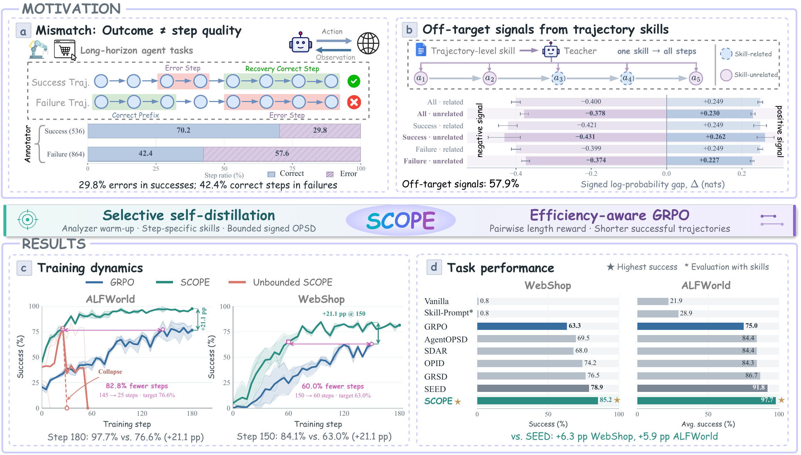
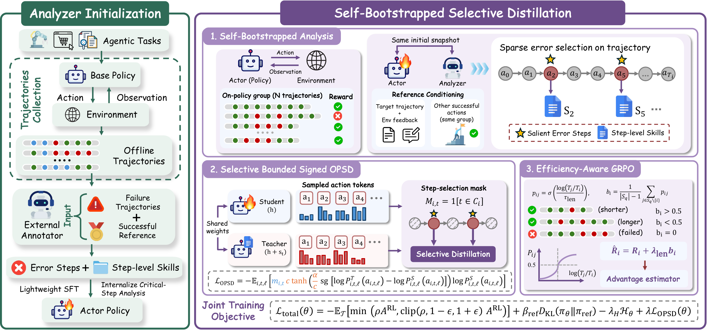
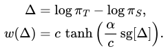
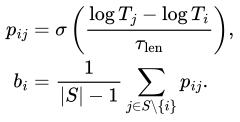

<div align="center">


**Selective Critical-Step On-Policy Self-Distillation**<br>
**for Agentic Reinforcement Learning**

<p>
  <strong>Qirui Liu</strong><sup>1,*</sup>, <strong>Wei Cao</strong><sup>1,*</sup>, Yu Mi<sup>1</sup>, Yichen Sun<sup>1</sup>,<br>
  Xuekun Zhang<sup>1</sup>, Lei Liu<sup>2</sup>, Yue Shen<sup>2</sup>, Zhixuan Chu<sup>1,†</sup><br>
  <sup>1</sup> Zhejiang University &nbsp;&nbsp; <sup>2</sup> Ant Group<br>
  <small>* Equal contribution &nbsp;&nbsp; † Corresponding author: <a href="mailto:zhixuanchu@zju.edu.cn">zhixuanchu@zju.edu.cn</a></small>
</p>

<p align="center">
  <a href="https://neuqrui.github.io/SCOPE-page/"></a>
  <a href="https://arxiv.org/abs/2610.38391"></a>
  <a href="https://github.com/neuqrui/SCOPE"></a>
  <a href="https://huggingface.co/collections/neuqrui/scope"></a>
  <a href="https://swanlab.cn/@67r/scope-exp/v1/vy74zd/overview"></a>
</p>
</div>

<p align="center">
  
</p>
<p align="center"><em>SCOPE at a glance: why agents need step-specific supervision, how SCOPE learns from critical steps, and its training dynamics and performance on ALFWorld and WebShop.</em></p>

## News

- **2026/10/28** — Our [paper](https://arxiv.org/abs/2610.38391) is available on arXiv.
- **2026/10/30** — Browse the [training curves](https://swanlab.cn/@67r/scope-exp/v1/vy74zd/overview) and released [SFT models and data](https://huggingface.co/collections/neuqrui/scope).

## Table of Contents

- [Overview](#overview)
- [Method](#method)
- [Results](#results)
- [Quick Start](#quick-start)
- [Citation](#citation)

## Overview

Long-horizon agents need feedback on individual decisions. A successful trajectory can contain mistakes that the agent later recovers from, while a failed trajectory can contain correct steps. Applying the same hindsight skill to an entire trajectory also introduces supervision at decisions unrelated to that skill.

**SCOPE** learns from self-generated, **step-specific corrective skills**. After a supervised warm-up, the policy analyzes its own successful and failed experience, identifies error steps, and distills the corresponding skills only at those decisions. A bounded signed distillation coefficient controls the auxiliary signal, and a success-relative pairwise reward encourages efficient task completion.

With **Qwen2.5-3B**, SCOPE achieves **97.7% ALFWorld success** and **85.2% WebShop success**, improving over SEED by **5.9** and **6.3 percentage points**. On ALFWorld Unseen, success rises from **66.4% to 89.6%** over GRPO, while reported average interactions fall by **46.7%**.

## Highlights

- **Self-bootstrapped step-level skills.** The policy serves as both actor and analyzer, turning its own experience into structured corrections with explicit target steps.
- **Selective, bounded signed OPSD.** Each skill conditions the teacher only at its assigned steps. A smooth tanh coefficient retains both reinforcement and suppression while bounding its magnitude.
- **Success-relative efficiency.** A soft pairwise comparison favors shorter successful trajectories within the same task group, without specifying an absolute target length.

At evaluation, the trained agent acts from the ordinary interaction history. Skills and analyzer calls are used during training; external annotation is confined to the offline warm-up.

<a id="method"></a>

## Method

<p align="center">
  
</p>
<p align="center"><em>SCOPE learning loop: collect experience → identify errors and generate step-level skills → combine selective self-distillation with efficiency-aware GRPO → update the policy and analyzer.</em></p>

**1. Initialize analysis.** Collect base-policy trajectories and annotate errors with corrective skills. Supervised fine-tuning teaches the policy the structured analysis format. Each skill entry contains `target_steps`, `error_reason`, and `skill`.

**2. Analyze on-policy experience.** Sample eight trajectories per task. The current policy snapshot analyzes both successful and failed rollouts; failures can additionally use up to three successful action sequences from the same group as references. The analyzer returns up to five skill entries, each assigned to one or more steps.

**3. Learn at the selected steps.** The skill-conditioned teacher and ordinary-context student score the same sampled response tokens. Teacher scores are cached before student optimization. Selected steps receive the bounded signed OPSD signal alongside GRPO; other steps receive ordinary RL updates.

**4. Reward efficient success.** Compare interaction lengths among successful trajectories for the same task. Add the resulting pairwise bonus to the task reward, then update the policy. The updated policy supplies both the actor and analyzer for the next iteration.

<details>
<summary><b>Bounded signed OPSD and pairwise reward</b></summary>

For a selected response token, let $\pi_T$ and $\pi_S$ denote teacher and student probabilities. We use the signed log-probability gap

<p align="center"></p>

Here `sg` stops gradients through the coefficient, $\alpha$ sets the slope near zero, and $c$ bounds its magnitude. The auxiliary loss averages $-w(\Delta)\log\pi_S$ over selected response tokens. Positive gaps reinforce a sampled token; negative gaps suppress it. An empty selection contributes zero auxiliary loss. Defaults are $\alpha=2.5$, $c=1$, and distillation weight $\lambda_{\mathrm{OPSD}}=0.01$.

For successful trajectory $i$, let $T_i$ count environment interactions and let $S$ be the set of successful trajectories in its task group. Pairwise preferences and the efficiency bonus are

<p align="center"></p>

The sigmoid $\sigma$ provides a smooth preference for the shorter success. The shaped reward is $R_i+\lambda_{\mathrm{len}}b_i$, with $\tau_{\mathrm{len}}=0.1$ and $\lambda_{\mathrm{len}}=5$. A lone success receives $b_i=1/2$; failures keep their original task reward. The comparison depends on length ratios and is invariant to multiplying all interaction lengths by the same positive factor.

</details>

Explore the [interactive method demos](https://neuqrui.github.io/SCOPE-page/#method) and [recorded ALFWorld / WebShop trajectories](https://neuqrui.github.io/SCOPE-page/#replay) on our project page.

<a id="results"></a>

## Results

SCOPE improves task completion across model sizes. The table reports success rate (%) for the SCOPE checkpoint at training step 150; a dash indicates that benchmark was not evaluated for that backbone.

| Backbone | ALFWorld Seen ↑ | ALFWorld Unseen ↑ | WebShop ↑ |
| :--- | ---: | ---: | ---: |
| Qwen2.5-3B-Instruct | **97.7** | **89.6** | **85.2** |
| Qwen2.5-7B-Instruct | **98.4** | — | **84.4** |
| Qwen3-1.7B | **92.2** | — | **78.9** |
| Qwen3-32B | **99.2** | **94.0** | — |

ALFWorld Seen and WebShop use 128 evaluation episodes; the Qwen3-32B ALFWorld Unseen result uses 134 episodes. On Qwen2.5-3B, SCOPE exceeds SEED by 5.9 percentage points on ALFWorld Seen and 6.3 percentage points on WebShop. Detailed baselines, ablations, and efficiency results appear in the [paper](https://arxiv.org/abs/2610.38391) and [project page](https://neuqrui.github.io/SCOPE-page/#results); the [training curves](https://swanlab.cn/@67r/scope-exp/v1/vy74zd/overview) are available on SwanLab.

## Training Defaults

Our launchers in [`scope/`](scope/) use step-specific skills (`skill_source=step_skill`), online policy analysis (`ana_backend=policy_vllm`), bounded signed OPSD (`OPSD_GATE=tanh`, $\alpha=2.5$, $c=1$), and a pairwise length reward (`LENGTH_REWARD=pairwise`, $\tau_{\mathrm{len}}=0.1$). Each task samples eight rollouts. The [Reproduction Guide](docs/reproduction.md) lists the full settings and ablation switches.

<a id="quick-start"></a>

## Quick Start

SCOPE builds on the [SDAR](https://github.com/ZJU-REAL/SDAR) / verl-agent stack and requires NVIDIA GPUs. Use separate environments for ALFWorld and WebShop.

```bash
git clone https://github.com/neuqrui/SCOPE.git
cd SCOPE
cp .env.example .env
```

Set the base-model paths or Hugging Face IDs in `.env`:

```dotenv
SCOPE_BASE_3B=Qwen/Qwen2.5-3B-Instruct
SCOPE_BASE_7B=Qwen/Qwen2.5-7B-Instruct
SCOPE_BASE_QWEN3=Qwen/Qwen3-1.7B
ALFWORLD_DATA=./data/alfworld
SWANLAB_MODE=local
```

<details>
<summary><b>Install ALFWorld · Python 3.12</b></summary>

```bash
conda create -n scope python=3.12 -y
conda activate scope
pip install vllm==0.11.0
pip install flash-attn==2.7.4.post1 --no-build-isolation --no-cache-dir
pip install -e .
pip install gymnasium==0.29.1 stable-baselines3==2.6.0 alfworld
```

Place the ALFWorld game files (`json_2.1.1`) under `data/alfworld`, or set `ALFWORLD_DATA` to the existing game directory. Sampling and evaluation use the task pools described in the [data preparation guide](docs/reproduction.md#data).

</details>

<details>
<summary><b>Install WebShop · Python 3.10</b></summary>

```bash
conda create -n scope-webshop python=3.10 -y
conda activate scope-webshop
cd agent_system/environments/env_package/webshop/webshop
./setup.sh -d small
cd ../../../../..
pip install torch==2.6.0 --index-url https://download.pytorch.org/whl/cu124
pip install flash-attn==2.7.4.post1 --no-build-isolation
pip install -e .
pip install vllm==0.8.2
```

The setup script downloads `items_shuffle_1000.json` and `items_ins_v2_1000.json`. Model and environment configuration is loaded from `.env` by the launchers.

</details>

### 1. Collect and annotate experience

```bash
# Qwen2.5-3B: sample 180 training tasks, eight rollouts per task.
SAMPLE_GPUS=0,1 bash scope/sample/run_alfworld_3b.sh
SAMPLE_GPUS=0,1 bash scope/sample/run_webshop_3b.sh
```

Annotate the collected trajectories using the [analyzer schema](verl/trainer/ppo/step_skill.py). Save each task/model's annotations as `train.jsonl` in its rollout directory, with one system–user–assistant conversation per line under `messages`:

```text
work/rollouts/scope/alfworld_qwen2.5_3b/train.jsonl
work/rollouts/scope/webshop_qwen2.5_3b/train.jsonl
```

The assistant target contains `trajectory_summary` and `step_skills`; each skill has `target_steps`, `error_reason`, and `skill`. We use GLM-5.2 for offline annotation. Online analysis uses the policy itself.

### 2. Warm up the analyzer

```bash
SFT_CUDA_VISIBLE_DEVICES=0,1 bash scope/sft/run_alfworld_3b.sh
SFT_CUDA_VISIBLE_DEVICES=0,1 bash scope/sft/run_webshop_3b.sh
```

Each task and backbone uses its own rollout sample, SFT annotations, and warm-up checkpoint. Checkpoints are written to `work/ckpt/sft/scope/<task>_<model>/global_step_*`.

### 3. Train SCOPE

```bash
bash scope/alfworld/run_alfworld_3b_step_skill.sh
bash scope/webshop/run_webshop_3b_step_skill.sh
```

The launchers load the latest matching SFT checkpoint, train for **180 updates**, and save at **step 150**. Validation runs every five updates using ordinary policy inputs. Default online runs use **8 GPUs for ALFWorld** and **2 GPUs for WebShop**; both use rollout tensor parallelism of 2.

Use `N_GPUS_PER_NODE` to change the device count or `SCOPE_RL_MODEL=/path/to/global_step_N` to select a warm-up checkpoint. Matching `7b` and `qwen3_1.7b` launchers are available in each stage. See the [full reproduction instructions](docs/reproduction.md) for model-specific settings.

## Layout

- [`scope/sample/`](scope/sample/) collects base-policy rollouts; [`scope/sft/`](scope/sft/) warms up the analyzer.
- [`scope/alfworld/`](scope/alfworld/) and [`scope/webshop/`](scope/webshop/) contain online training launchers; [`scope/env.sh`](scope/env.sh) sets model paths and method defaults.
- [`verl/trainer/ppo/step_skill.py`](verl/trainer/ppo/step_skill.py) handles skill parsing and step selection; [`verl/trainer/ppo/opsd_kl_utils.py`](verl/trainer/ppo/opsd_kl_utils.py) implements bounded signed distillation.
- [`agent_system/reward_manager/episode.py`](agent_system/reward_manager/episode.py) implements the pairwise reward. See [`docs/reproduction.md`](docs/reproduction.md) for the reproduction guide.

## Acknowledgements

We build on [SDAR](https://github.com/ZJU-REAL/SDAR), [verl](https://github.com/volcengine/verl), and [verl-agent](https://github.com/langfengQ/verl-agent), and evaluate on [ALFWorld](https://github.com/alfworld/alfworld) and [WebShop](https://github.com/princeton-nlp/WebShop). We thank the authors and maintainers of these projects.

## License

This repository is released under the [Apache License 2.0](LICENSE). Upstream code and datasets retain their respective licenses.

<a id="citation"></a>

## Citation

If you use SCOPE in your research, please cite our [arXiv paper](https://arxiv.org/abs/2610.38391):

```bibtex
@misc{liu2026scopeselectivecriticalsteponpolicy,
      title={SCOPE: Selective Critical-Step On-Policy Self-Distillation for Agentic Reinforcement Learning},
      author={Qirui Liu and Wei Cao and Yu Mi and Yichen Sun and Xuekun Zhang and Lei Liu and Yue Shen and Zhixuan Chu},
      year={2026},
      eprint={2610.38391},
      archivePrefix={arXiv},
      primaryClass={cs.AI},
      url={https://arxiv.org/abs/2610.38391},
}
```
